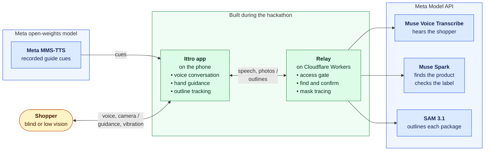

  

<h1 align="center">Ittro</h1>

  <b>A voice-first Android app that finds the requested product on a shelf, guides a blind shopper’s hand to it, and checks its label before confirming it’s the right one.</b>

  
  
  
  

Ittro is our entry for the Meta Global AI Developer Hackathon (Indie track). A blind shopper asks what is on the shelf, names the product they want, and Ittro guides their hand to it by voice, ticks and vibration. When the hand closes on a product, Ittro reads it and says yes only when the label matches. A wrong yes is the worst outcome, so "I can't confirm yet" always beats a guess.

There are no buttons to find: every word on screen is spoken, and every wait has a sound. The demo is in English; Arabic and French are one spoken command away.

## How it works

The shopper is on the left; green is what was built during the hackathon; blue are the Meta models it uses. Every piece is dated in the [build log](docs/BUILD_LOG.md), which also has [the full map](docs/BUILD_LOG.md#the-whole-system).

| Meta model | What it does in Ittro |
|---|---|
| **Muse Voice Transcribe** | Hears every sentence over a live stream through the relay, in English, Arabic and French. |
| **Muse Spark** | Understands each request, describes the shelf, boxes each matching package in the photo, and checks the product in the hand. Every call uses strict structured output. |
| **SAM 3.1** | Cuts each box Spark found into a mask; the relay traces it into the outline the phone keeps on the product as it moves. |
| **MMS-TTS** | Speaks the 30 fixed cues in English and French, recorded and shipped with the app. Sentences and all Arabic use the phone's own voice. |

The phone never holds the Meta API key: only the relay calls Meta.

## Built with

- **[Expo](https://expo.dev) 58 and React Native 0.88**, in TypeScript: the Android app (`app/`).
- **[XState](https://stately.ai/docs/xstate) 5:** one statechart runs the whole conversation.
- **`expo-camera`, `expo-audio` and `expo-speech`:** the camera, the recorded cues and the phone's voice.
- **Kotlin** (`modules/ittro-sensors/`): the 24 kHz mic stream, live camera frames, the outline that follows the gyroscope and the camera's motion, and the earbud and volume buttons.
- **[MediaPipe](https://ai.google.dev/edge/mediapipe) Tasks Vision:** finds the shopper's hand in the camera frames.
- **[Cloudflare Workers](https://workers.cloudflare.com)** (`relay/`): the TypeScript relay with the access code, rate limit and daily spending limit, every Meta call, and the sighted-helper page.
- **Meta's [`@meta-sam/parser`](relay/licenses/SAM-License.txt):** reads SAM's masks before the relay traces them into outlines.
- **Meta Model API:** Muse Spark, SAM 3.1 and Muse Voice Transcribe; **Meta MMS-TTS** for the recorded cues.
- **Node 22, `node --test` and ESLint:** the tests and the lints.
- **GitHub Actions and release-please:** tests and a fresh Android build on every pull request, and signed APKs on [GitHub Releases](https://github.com/AmineYagoub/ittro/releases).

## What was built during the hackathon

Everything in this repository dates from 26 October 2026 onward, except the existing tools it is built on. The day-by-day summary, every change with its commit, and what was not built here are in [docs/BUILD_LOG.md](docs/BUILD_LOG.md).

## Try it

Download the APK from the [latest release](https://github.com/AmineYagoub/ittro/releases/latest) and install it on an Android phone (64-bit ARM, Android 7 or later). It talks to our relay, so it works as soon as it is installed, within the relay's daily spending limit. Point the phone at a shelf and say "What's on the shelf?".

To build and test from source, see [CONTRIBUTING.md](CONTRIBUTING.md#set-up).

## Contributing

New contributors are welcome. Pick an issue labelled [good first issue](https://github.com/AmineYagoub/ittro/issues?q=is%3Aissue+is%3Aopen+label%3A%22good+first+issue%22), comment `/take`, and follow [CONTRIBUTING.md](CONTRIBUTING.md): it has the setup, the checks CI runs, and a map of the code.

## Licence

[MIT](LICENSE). Meta's MMS-TTS voices (`facebook/mms-tts-eng`, `facebook/mms-tts-fra`) are CC BY-NC 4.0: non-commercial use, credit to Meta. Meta's `@meta-sam/parser` is under the [SAM License](relay/licenses/SAM-License.txt). MediaPipe and its `hand_landmarker` model are Apache 2.0.
