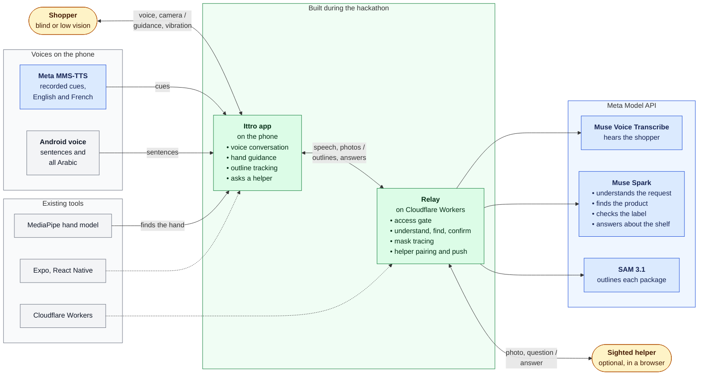

# Ittro build log

A dated log of what was built each day, for the hackathon submission. New work only: everything here dates from 26 October 2026 onward.

## The whole system

Everything Ittro does, in one map. The [README](../README.md) shows the short version. Green is what was built during the hackathon, blue are Meta's models, grey are existing tools. The sighted helper is optional and not part of the demo.

## What was built during the event

New work only, 26 October 2026 onward. Each day below has every change with its commit; what was not built here is at the end.

- 27 Oct: repo from template, Expo app with camera screen, Kotlin sensor skeleton, relay with strict Spark gate, trilingual design pack (31 screens, 11 sounds, 30 voice cues).
- 28 Oct: spoken conversation as one statechart, proven on the real phone; realtime Voice Transcribe streaming; silence clock, epoch stale-guards, language switching; shelf search (SAM outlines, label reads, tracker, masks); background-talk ignore; re-say of dropped lines.
- 29 Oct: lone product names always answered; hand guiding from live camera frames with clips, ticks and meter; in-hand confirm with yes/no/unsure/picture verdicts and word-for-word detail reads; earbud and volume buttons; helper pairing, asking and answers; link states, brand memory, per-search timing logs and the phone measurement procedure.
- 30 Oct: fixes from the first phone runs: each line said once, Ittro never answers its own voice, the found product announced by name at once, only the found product outlined, label reads at minimal effort.
- 31 Oct: an outside reviewer's commit (mic muted while Ittro speaks, one guide target, deadlines on every call); the target kept by what it reads; a clear request searched at once; the touch on the guided product starts the check.
- 1 Nov: SAM's own outline drawn natively and following the camera, a 4:3 preview, finer outlines; reflections never the product; the last shelf read again at once for the next request; a named variety must be the one on the label.
- 1 Nov, evening: the grounding find (Spark boxes each matching package, SAM cuts each box); questions about the shelf answered on the spot; the shelf named in the shopper's language, and a wrong shelf says so; a sweep that remembers what each stop read.
- 2 Nov: fixes from phone tests t21–t44: the plain mic, so Ittro keeps hearing; the outline moves with the phone's turn from the gyroscope, grows and shrinks as the phone steps closer, and holds while the hand reaches; it is cut again while the phone moves; the relay mends SAM's torn mask rows; the relay is type-checked.
- 3 Nov: CI on every pull request and signed releases built by CI (v0.1.0, then v0.1.1 with the hand model); fixes from phone tests t45–t56 for the recorded demo: a shorter first launch, one live voice, the mic that opens when a line ends, and guidance cues nothing cuts; from a code review, a yes that needs every word and amount on the label to agree.

## 3 November 2026

- CI checks every pull request: the app's lint, type check and tests, the relay's checks, the sensor module's lint, and a release APK built from a fresh prebuild with its permissions checked against an allowlist. A fresh prebuild had failed since 30 October, because the network plugin's file step returned nothing; it now returns its mod (#1).
- release-please versions the app and the relay together from the pull request titles. On a release, CI builds the APK from the tag with the relay's access code, signs it and attaches it to the release with its checksum, then deploys the relay and checks it (#1). The first release, v0.1.0, was built and published this way (#2).
- The fixes from phone tests t21–t44 reached `main` as one squashed pull request (#3); each is listed under 2 November with its own commit.
- v0.1.0 shipped without MediaPipe's hand model: the model is gitignored and the APK build never fetched it, so on the phone (t45) no hand was seen and every in-hand check was dropped as "hand missing". The build now fetches it against a pinned hash and fails when the APK lacks it (#4); v0.1.1 carries it (#5).
- Fixes from phone tests t45–t56, each found on the phone and fixed by cause, with a test that fails without it:
  - Start: first launch ends with the language, after the three language prompts and one switch line; the privacy, volume-key and tour lines are gone, and the tour's yes/no step no longer swallows a question (t45, t46). Every open starts fresh, without taking up the last search.
  - Voice: English prefers a male US voice, nearest the MMS cue clips, over the Indian English voice t45–t47 picked, and the first line waits for the pick (t50).
  - Hearing: the mic opens when a line ends, not when its word-count estimate runs out; in t49 the estimate outlived the audio by 3.4 s and cut the shopper's answer, which had to be said twice.
  - Shelf question: a camera the question opened gets 1 s to focus before its photo (t54: "I cannot read anything on this shelf").
  - Guidance: ticks and chimes play on their own player, so they no longer stop each cue a fifth of a second in, which showed its text with nothing heard (t54); the six-second repeat keeps its cue, so the next frame no longer cuts it (t56); "two Masad bottle bottles" is said "two Masad bottles" (t56).
- Fixes from a code review of the in-hand check, each with a test that fails without it:
  - A yes needs the label to agree word by word: a word that changes the product ("unsalted" for "salted", "Coca-Cola Zero" for "Coca-Cola", "sans", "بدون") or another amount is a no. Sizes read the decimal comma and the Arabic decimal sign, so 1,5 L no longer matches 1,75 L, and compare across units, so 1 kg matches 1000 g (42d604f).
  - A hand fix older than 2 s voids the answer whenever it was taken; a fix taken just after the photo had passed however old it was, so a yes could land on a product already put back (1166685).
  - The 15 s relay deadline holds until the answer is read, so an answer that stalls halfway is said as the link down instead of a silent wait (322595c).

## 2 November 2026

- The relay and its tests are now type-checked with `npm run typecheck`. Wrangler bundles the relay without checking types, which is how the `addSpendUsd` call without an import reached the deployed Worker. The check fails on the relay as it was before 74c233a, and the bundle Wrangler builds is unchanged. Node's types (`@types/node` 22) were added for the tests only, and ten type errors in four test files, never checked before, are fixed (50646a3).
- Fixes from phone tests t21–t44, each found on the phone and fixed by cause (#3):
  - Hearing: an offered choice is heard while Ittro thinks (a4efbb9); a stream that has heard nothing for 30 s is reopened (3ccc609); Ittro keeps hearing the shopper after a yes (f6c163d); the mic records from the plain source, which ended the deafness of t25 and t26 (5fa811a); another spelling of the asked name counts as the asked name (218a3c3).
  - The outline follows the phone: it follows slow drift and holds under the hand (3fffd30); exposure changes no longer read as motion (d60a54d); it moves with the gyroscope while a hand is in view (f91f5c8) and on a fast turn (d83b969); it grows and shrinks as the phone steps closer or back (41b4959); the gyroscope's creep is learned while the phone holds still and taken off the turn (8b3c24e, d91a634).
  - The outline is cut again: once the phone rests after a move (f7bc11d), while it moves and with a hand clear of the product (4ddfce4); every cut is placed on the still it was cut from (6112885, 9fa3b74, 1f44fb4); the outline is kept while the product is out of view, and out of view is said once (641c10e, b018faa).
  - The relay mends rows SAM left short, so a clear bottle's outline no longer zig-zags into the bottle beside it (1445d5f).

## 1 November 2026, evening

- Phone run t20 (`/find` on the phone), each finding fixed by cause:
  - `/find` was not faster than the old path on the phone: the grounding call took 3–3.9 s and the whole find 5.4–7.0 s over 4G. It used fewer calls and gave no wrong yes, so it stays. Half-size photos missed products, so photos stay full size.
  - The find waited up to 2 s for frames sharp enough for small crop reads; it reads whole packages, so its bar is now 600 (1176ea1).
  - The several-matches line said the count in digits in Arabic; it now says it in Arabic words (ecefeab).
  - A start while the stream socket was still opening closed it 3.7 s in; that socket is now kept (f75be0d).
- The whole shelf-awareness plan is built (`docs/design/shelf-awareness-plan.md`, steps C and 0–8; voice B is not built):
  - Voice A: each language speaks in its most natural installed voice, logged at start, dropped after an engine error (94c9339). Decision record 0001 covers it and part 7; it is still Proposed.
  - Step 0 moved the search types, routes and loop wiring out of the full files, with no change in behaviour (33ef57f).
  - Questions about the view: `POST /ask-view` answers from the latest shelf still with the last four exchanges, the shelf inventory and the shopper's tone (2bf90c7). The understanding call carries the still and answers a question in the same call when it can (7db626e). The app says "let me look…" as a question ends, opens the camera when needed, gives up aloud after 15 s, and offers to take the shopper to a named product; yes starts the normal find (a05fa58).
  - The shelf inventory keeps every product the reads and finds name, and where (abb5571).
  - The sweep with memory: when the product is not in view and the camera's pan is known, Ittro walks the phone along the shelf in overlapping steps and reads once at each stop, with stop, slower, and a walk along a shelf that runs on. At the end, Muse Spark names what is there instead and offers the closest product by name. This replaces the word-overlap close match, which never matched across scripts (39faae8).
  - A wrong shelf names itself in the shopper's language, "هذا رف البقوليات", and says to ask someone nearby and then say «ابحث من جديد», which restarts the search and the sweep (58cbf6a, 1eecb4d).
- Found while type-checking the relay: since d7a7106 (31 October) the deployed `/realtime` route called `addSpendUsd` without importing it. Every 30 s of processed audio the charge threw inside Meta's message handler, so the event that crossed the mark never reached the phone. That event could be a final transcript. No streamed audio was counted against the daily budget, and the end of a stream threw before closing Meta's socket. The local relay used in t16 built its own budget and did not have the bug. Fixed with a route test that failed before the fix (74c233a).
- Checked live against Muse Spark on the founder's shelf frames, each run twice:
  - Five of the plan's six questions passed both runs. "Which rice is cheaper?" said both times that it could not tell whose the 220 tag was. That is the safe answer but not the table's, and one of those two answers took 15.6 s, past the app's 15 s limit.
  - The not-here run offered white rice on all six tries and invented nothing.
  - The scene check passed 14 of 14 (fits and shelf names), and «ابحث من جديد», "look again" and "cherchez encore" are understood as keep looking, 16 of 16 with the neighbouring intents.
- Reviewed by three independent reviewers, one each for the relay, the conversation and the shelf loop. Each finding was first shown by a test that failed, then fixed:
  - Relay (cc978ba): a Meta call whose answer failed its check was never charged; it is now. A body that is too big or not a JSON object gets a 400 instead of an uncaught throw, and the text pasted into prompts is capped. The view check refused what the strict schema allows, which turned any sentence said with a still into a 502; it now checks shape only, and a long answer is cut at its last full sentence.
  - Conversation (c03d6be): "Is there honey?" could get the answer meant for its first words, "Is there". The view offer could be changed by a search's own offer arriving meanwhile. "Stop" said while an answer was on its way went unheard. A follow-up asked the shopper to point the phone again. The acknowledgement could play while asleep, or over the heard earcon. Each is fixed, and the camera opened for a question now stays on 20 s.
  - Shelf loop (88ba1a7): a stop could be read from a sharper still left from the stop before. A sweep started while the hand was guided stopped every later pass. A camera that never turned was told "I checked the whole shelf" after 75 s. A wrong turn was never corrected, and a cue still queued ran down its clocks before it was said. A second walk could send the shopper back over the shelf just swept, the count named a product once per stop, and a new search's summary was told what an earlier shelf held. Each is fixed. A stop is now read 1.5 s after "stop", once the camera settled, and an unsure label there is read again.
- Proven on the Mac: 467 app tests, 123 relay tests, the relay typecheck, tsc and lints clean.
- Weak:
  - Nothing above has run on the phone. t21 checks the questions, the offer, the sweep's pan direction and "stop" timing, the not-here summary, the wrong shelf and voice A.
  - The relay commits are not deployed: 2bf90c7, 7db626e, 74c233a, 58cbf6a and cc978ba. They are server scope, and two of them send the shelf still with questions, so the founder reviews them before any push or deploy. Until then the deployed `/realtime` still drops the event at each 30 s charge.
  - A stop is reached when the turn passes it, so a large overshoot can still leave a gap between two reads.

## 1 November 2026, afternoon

- Deployed: the relay now runs on Cloudflare Workers at `ittro.djazair.dev` with its helper store (a719c39), so phone runs no longer need adb reverse. A Worker opens an outbound WebSocket only on `wss://`, so the deployed relay heard nothing in t16 until Meta's transcribe stream opened on `wss` and a failed open became a spoken failure (2a697f6).
- Phone runs t16–t19, each fixed by cause from its log:
  - «ابحث عن غيره» was dropped as echo when said in the quiet after a line; anything heard 2.5 s after Ittro went quiet is now the shopper (a6431e0).
  - The outline drifted off the bottle: a cut can reach the phone 11–16 s after its still, older than the 8 s ring of camera motion. The ring now holds about 70 s, and t19 placed every cut 33–40 ms from its still (af05750).
  - After a yes, the reminder repeated the whole yes line; it now repeats only the choice (ce3fdff).
  - The yes named the product in English word order in Arabic; the relay now asks for the language's own order, «ماء قديلة» (5d39705).
  - After a no, the way back was judged from the target's old box against the middle of the frame; it now runs from the hand to where the camera has the target (04a20dc).
  - A rest read that ended after guiding stopped said the internet was lost; it now says nothing (d88727a).
  - With two Guedila bottles, each recheck jumped to the biggest one; it now keeps the one nearest the guided spot (c490f9e).
  - t19 proved the drift fix, the reminder, the word order, touch to yes in 4.9 s and no stream drops. «ابحث عن غيره» after its fix and the direction after a no were not exercised on the phone.
- Measured: photo to outline took 11–16 s on the old path, most of it uploads over the founder's 4G link. Lower JPEG quality cut the upload but hurt SAM, so it was not kept.
- Privacy: every Muse Spark and SAM call sends `store: false`, so Meta keeps no shelf photo or hand crop (34d9f0e, plan step A).
- Faster find (plan steps B1, B2):
  - The relay's `POST /find` asks Muse Spark for the box and printed name of every package that is the request, then one SAM 3.1 box-prompt call outlines them (cab79fc).
  - The app's shelf loop uses it on a fresh shelf: one upload, the found line first, then the outlines (91d701f). Nothing in view goes down the old phrase path in the same pass, which still gives the close match, the swept shelf and the turn. Guiding, rechecks and the hand check keep the old path. `EXPO_PUBLIC_FIND=off` builds the old path for comparison.
  - Live through the deployed relay from the Mac: Basmati outlined in 5.8 s round trip, an empty shelf answered in 3.2 s. On six shelf-video frames it found the right products and none on the two frames without them.
- Proven on the Mac: 408 app tests, 108 relay tests, tsc and lints clean.
- Weak:
  - `/find` has not run on the phone; the next run (t20) times it against t19.
  - The full 21-frame replay through the app's loop (plan step B3) was not rerun with `/find`. The same prompt passed it twice on 1 November morning, outside the app.

## 1 November 2026

- Who wrote it: Claude (Claude Code), not Muse Code. The founder's rule of 31 October was that if Muse Code's fix-4 round failed its phone run, Claude would take over the core path (target tracking, guiding, the in-hand check, the mic gate). It failed on t6, so every commit on `review/demo-fixes` from 68b7bf0 (31 October) onward was written by Claude and carries no Muse Code trailer. Muse Code's last commit is 8748fd0.
- Phone runs t9–t15 (the founder's hand, real Masaad and Guedila bottles; t15 on a real shop shelf), each fixed by cause from its log. t13 passed the full Arabic path twice: request → SAM outline on the bottle, following the phone → touch → spoken check → green yes in 3.5–4.3 s → «ابحث عن غيره» → a new search → «انتهيت».
- Outline: the guided product is drawn with SAM 3.1's own outline, not its box (a88d7ee). The relay keeps a bottle's neck and shoulders, up to 128 points from 64–128 mask rows (2972142, ec4efe1). The outline is drawn natively over the camera and moved on every frame by the picture's motion around it, as the 26 October project did; hand detection moved to its own thread, and a cut that arrives late is placed by the motion since its still (efb0975). The preview is a 4:3 stream laid out the way outlines are mapped (5b29192), and the name pill sits on the bottle's cap (72718fe).
- Guiding and the touch:
  - A touch now checks what the hand holds before the green yes (f328462), and the yes card shows the shelf crop (b6fd18f).
  - A bottle's neck above SAM's box counts as the product (1f430fb).
  - A hand reaching over the product holds its whole outline (880f3c2).
  - The guide steers by where the camera has the product, not where it was (cb2a4ef).
  - An offered choice ("find another, or done") said while Ittro is quiet is the shopper's, never echo (541e2ad).
  - The yes names the product as Ittro has been calling it (b016ce7).
- Search:
  - Reflections are never the product, and a recheck stays on the guided product (f686000, 83ac4fb).
  - The shelf phrase is asked while waiting for a sharp frame (da13772), and the short word SAM answered to is asked first after (a4e8a66).
  - "I see N products" is said once a search (63643b2).
  - The next request reads the last shelf at once, with no photo and no SAM, if the camera opening is the same and it moved less than a quarter of the frame (f6d6492, 244be49, a8bc182).
- Offline replay of the founder's 10 s shelf video (22 frames, live Meta calls, outside the repo) found two bugs:
  - Eleven jars made a nine-crop read, which the relay refuses; crops now go in calls of at most eight (8bb867d).
  - "White rice" read yes on Riz Basmati; a variety named in the request must now be the one on the label (40625fd).
- The same video tested Muse Spark grounding followed by a SAM box prompt as a faster find: 78 of 79 present and 80 of 80 absent cases right, median 3.7–4.1 s to the outline. Not in the app yet.
- Plan for after phone run t16, design only: `docs/design/shelf-awareness-plan.md` covers `store: false` on every Meta call, the grounding find, asking what's in view, a sweep with memory, not-here answers, a more natural conversation and one voice per language.
- Proven on the Mac: 398 app tests, 99 relay tests, tsc and all three lints clean. The sensors index moved its camera types to `camera.ts` at the 300-line limit (6004ca7), and the phone log report times a search from its start when there is no confirm turn (see measure.md).
- Weak:
  - t16 has not run, so everything from b016ce7 on is unproven on the phone.
  - The relay runs locally through adb reverse; the deployed relay predates these fixes.
  - English and French speak cues in the MMS voice and sentences in the phone's voice.
  - Arabic and French lines await a native speaker's review.

## 31 October 2026

- Outside review, not Muse Code: two independent code reviews of 1aa578b were run at the founder's request, and one reviewer also wrote commit 7669d82 ("Demo fixes: gate the mic while speaking, one guide target, deadlines everywhere") on branch `review/demo-fixes`. Muse Code did not write that commit, and it carries no Muse Code trailer. It mutes the microphone uplink while Ittro speaks, makes the rectangle and the steering follow one target, adds deadlines to every relay and Meta call, pauses shelf reads while guiding, freezes the pan while a hand moves, and raises the relay limits for demo day (120 calls a minute, 15 USD a day). Kept as written, by the founder's decision; the Muse Code commits after it build on top of it.

- Demo hold-up round 3 (branch `review/demo-fixes`, on top of the reviewer's 7669d82): all 11 phone-run-4 findings fixed by cause from the t5 log, each with a Mac test that would have caught it, proven with no phone use (349 app tests, 96 relay tests, tsc and all three lints clean; the t5 replay fails on 7669d82 at the exact phone fault and passes now). The target is kept by what it reads, not where it sits: a pause drops the target so resume says one line and looks fresh; a hand on the product freezes the box in the statechart, the guide loop and the shelf loop; a jumped box holds and asks for a label recheck; the shelf loop re-reads to confirm after a jump, a loss or a recheck and every guide state adopts the re-found box silently, lost ones resuming aiming. The t5 tips and boxes replay through the loop and the statechart to the green yes verdict with out of view never spoken. Contact waits for the covering announcement so a reaching hand always moves on to the check. The mic gate follows the audio the speaker plays: engine start/end callbacks bracket it, a late start re-closes it, a settle poll holds it while the engine reports speaking, the tail is 800 ms, clips gate before the first sound. A yes needs every asked attribute read and matched (contradiction becomes no, missing becomes unsure, sizes by number and unit); a missing or stale hand voids the answer into a reread. The check crops three hand widths around the hand and flies two reads at once (live Meta: a quarter-size image reads in 3.4 s against 4.7 s full frame, and downscaling alone misreads, so crops win both ways). The caption clears the direction cluster by construction. The unused /spark and /transcribe routes are gone; KV counters are sharded four ways. The hands log rebases on a native counter restart; the 9 to 7/s and detect p50 100 to 123 ms deltas are session variance, not the round (no added work on the native path). The phone check list is in the report.
- Weak: the 1 s / 5 s / 4 s targets are proven only in the driver clock and one live crop-vs-full read (3.4 s vs 4.7 s); the verdict-in-4 s needs the phone's capture plus a crop read. Same-product-by-read assumes the recheck read is right; a misread under a moving hand holds the old box until the next pass. Barge-in by voice stays closed through each line plus ~1 s (button still interrupts). Screen PNGs 05/27/29 and all-screens.png still show the old outlines (HTML updated; re-export needed).
- Claude takes over (see 1 November for the rule): phone runs t6–t8 with the founder's hand.
  - The check crops the held product, not just the hand (68b7bf0), and a turned label keeps it reading (1a285d3).
  - The kind is judged from the item when the label doesn't print it (2c35e3f), and a held product may sway within a hand width (caf1a28).
  - A fingertip on the confirmed product starts the check, as in the 26 October project (d0d97e8), and a hand wrapped round the product touches it (234e087).
  - «هذا هو؟» is "is this the right one?" (0614b62), and the products line agrees with its count (2017fd0).
  - A clear request starts the search at once, with no "Is that right?" turn, by the founder's call (32ebe5c).
  - The shelf phrase is kept per product across searches (b256d22).

## 30 October 2026

- Demo hold-up round 2: all 9 phone-run-2 findings fixed by cause from the t2 log, each with a Mac test that would have caught it, proven with no phone use (312 app tests, 89 relay tests, tsc and all three lints clean, debug APK builds offline; live relay 46/46 understand cases in 126 s with the product name asserted on 4 new misspelled and wordy cases). A pre-yes find announces right after yes with no searching line; outlines after the find queue nothing stale; a find drops the close alternative; arming waits for a free moment. A no guides straight back to the shelf target or searches again, and a helper no does the same; checking the hand stops guidance; the "say guide me" ask is gone from the lines, DESIGN.md and screen 07 while the words still work; a restart flag keeps the resume from re-announcing. Own voice never routes: Arabic folds diacritics and hamza, a voice log keeps recent lines for exact matches, and while the voice is fresh its first words and near-verbatim wobbles drop too, speculatively included; a bare yes or no still answers its open question. The rectangle follows the best-overlapping box across passes, hides out of view, and the pill clamps on screen. Reads and checks run at minimal effort (same verdicts live: two crops ~7.3 s vs ~9.4 s, a full frame confirms in ~5.9 s vs ~10.7 s); blurry frames wait for a sharper one, reading anyway after two waits. Each cue holds half a second before it speaks and the find points from the hand. The caption lands when speech starts. The engine warms on a language switch and each line logs when speech starts. The phone check list is in the report.
- Demo hold-up round: all 14 phone-run-1 findings fixed by cause from the r4/r5/relay logs, each with a Mac test that would have caught it, proven with no phone use (279 app tests, 85 relay tests, tsc and all three lints clean, sensors module compiles offline, debug APK builds offline). Placeholders gone: yes says it is searching for the product by name, the found line names the product and its side once the queues drain. The mic stays live while Ittro speaks: own lines drop, own-plus-more strips to the rest, and a three-word fragment of a long own line is an echo, so the shopper can barge in and Ittro never answers itself. Every line plays once: say retries at most once, engine state tells slow from played-but-unacked from dropped, clips end on player state. Speed: a stable speculative yes routes at speech end, 800 ms after the last partial, or on a late answer; confirm flies one shot at a time with checking said once; unsure shelf tracks re-read within 2.5 s with 8%-wider crops. Silence never fires during a question, a check or guiding, and the verdict re-arms it through a transient state. Guide me after a no restarts the search and the hand guide from the kept shelf target; the no names the short product and its side; a test walks every chip on every screen to its route. Declining the language offer translates the request into the current language before routing; confirm reads come back transliterated into the request script; the spoken line pins its paragraph direction and the verdict screen reuses it. Only the found target is drawn: the blue overlay is deleted, the green rectangle follows its track at pan speed and holds its last box when the track drops, the pill shows the short name, and DESIGN.md with screens 05/27/29 say target-only. An empty reread keeps the Maybe photo and reading. Native: pan shifts search coarse to fine (identical shifts at a third of the cost, proven by compiling the real TrackPan old and new against stubs: 96/96 exact on synthetic shifts, 2.86× faster) and pan every 200 ms to recover the design rate; MediaPipe 0.10.14 offers no thread API so the CPU setting stands. Test builds log in release behind a setting and may use HTTP to localhost only; the stream backs off 1/2/4…30 s. The phone check list is in the report.
- Weak: TTS end-callback truth, clip completion, mic-live echo in room noise, hand fps and heat, overlay drift at camera speed, TalkBack, pause/lock, Arabic/French switching and late answers are phone measurements; the 1 s / 5 s / 4 s targets are proven only in the driver clock. Detect p50 (~110 ms) is contention-bound (benchmark-clean 54 ms cold, 23 ms tracking; thread pinning and smaller input deliberately not taken blind). Screen PNGs 05/27/29 and all-screens.png still show the old outlines (HTML updated; re-export needed). Detail reads still quote the label script verbatim. `app/android` stays gitignored prebuild output: Claude must prebuild (the localhost exception ships as a config plugin).

## 29 October 2026

- Submission prepared, nothing published (no push, repo stays private, no deploy, no form submitted). New: the 3-minute demo video script (`docs/demo-script.md`: one English search end to end, a wrong Guedila bottle caught, the Masaad bottle confirmed, a switch to Arabic, the four Meta models named shot by shot), the rewritten README (what it does, each Meta model's job, the statechart diagram, how to run it, event work, licences), the final check list (`docs/submission-checklist.md`) and the Cerebral Valley submission text (`docs/submission-text.md`). Phone numbers stay marked placeholders in the README and the script until Claude's 20-minute session and the founder's 10-product set run. Mac proof: 227 app tests and 84 relay tests pass, tsc and all three lints clean, debug APK builds offline, whole-history secrets scan clean (the one `sk-` hit is the `ask-someone` test ids), SAM License copy ships, every doc link resolves, every commit dated 27–29 Oct 2026.
- Weak: wrangler is not installed on the Mac, so `relay` `npm run dev` is documented but unrun here; the video link, the public-repo flip and the form paste are the founder's steps in the checklist.
- Dependability and measurement, proven on the Mac with no phone use (227 app tests, 84 relay tests, tsc and all lints clean, debug APK builds offline; live relay 42/42 understand cases in 109 s). The relay keeps pairings, helpers and questions in its own KV (`ITTRO_HELPERS`, new binding of the same kind as `ITTRO_LIMITS`) so they survive across isolates, with the same expiries (pairings 10 min, questions 30 min) and the photo gone on answer, cancel or expiry; without the binding it falls back to memory, and deploying needs `wrangler kv namespace create ITTRO_HELPERS` with the id in `relay/wrangler.jsonc`. The link is a statechart region: network loss, limits (429/402) and broken answers are states, each said once with what to do, and any success recovers on its own; every Meta call logs sent/ok/failed with milliseconds and carries its kind. Confirmed brand words persist on the phone and join the mic keywords next stream. Timing: every state change logs with its time, each search logs request confirmed, first outline, hand on product and verdict, and a minute sampler logs battery, heat and native memory; `app/scripts/log-report.mjs` turns a saved phone log into the report (proven on the phase 3 and review-2 phone logs and two simulated sessions), and `docs/measure.md` holds the 20-minute session and the 10-product set with the founder. Mac proof: pair→join→ask→status through the real worker across simulated isolates, live Meta understand over HTTP through the new meta-call path (ok 1184 ms, wrong code → broken/401), KV TTLs asserted (600/1800 s). The phone check list is in the report.
- Weak: no phone numbers yet (the 20-minute drain/heat/memory curve and the 10-product found/wrong-yes/verdict table are Claude's and the founder's runs); two helper joins racing the same code across isolates can both succeed (KV has no compare-and-set); native memory is device-wide avail/total, not Ittro's own heap; Arabic/French link and brand sentences await a native-speaker review; the deployed relay still predates the KV store and the new prompt (deploying is the maintainer's call).
- Phase 7 buttons and asking a person, proven on the Mac with no phone use (213 app tests, 80 relay tests, tsc and all lints clean, debug APK builds offline; Mac log in `reports/helper-mac-run.log`, gitignored). Buttons: every press builds the same understood answer the word would, routed from the talk level so it lands in every substate and interrupts speech and understanding; single is yes at a yes/no question, got-it after Reach forward, else repeat; double no; triple help; hold and volume-hold stop and wake (volume-hold also repeats the last line). Native: a platform media session classifies presses (next/previous track count as double/triple, voice-assist as hold), a headset receiver reports wired and Bluetooth connection, and a config plugin plus MainActivity forward the 0.8 s volume-down hold (short presses still change the volume, one step per hold). First launch teaches the volume key; earbuds connecting teach the presses once per connection; help names the button only while earbuds are on; five presses with no hold teach the volume key once. Helper: `add a helper` pairs by spoken six-digit code (10 min expiry), `ask someone`/`ask Sara` confirm before anything leaves the phone, waiting is a statechart state (2 s ticks 10 s, pulse every 5 s, `Still waiting` every 30 s, give-up at 5 min), answers speak like Ittro's own with the helper's name, and two unreadable reads in a row offer asking once. The relay serves pairing, questions with photos, answers and the helper page (`/help`, light theme per screen 19) with signal-only VAPID push tickles (Web Crypto, no new packages; keys in gitignored `relay/.dev.vars`); photos delete on answer, cancel or 30 min, and the app polls every 3 s. Mac proof: full pair→join→ask→answer→delete flow through the real worker (all endpoints 0–3 ms), the same flow driven in real headless Chrome (8/8 DOM checks: code typed, joined, question+photo+read shown, yes+note answered, thanks shown, shopper sees it), and the live understand set extended to 42 cases (ask someone/Sara/again, stop/never-mind waiting, add helper/Sara) at 42/42 in 105 s. The phone check list is in the report.
- Weak: no press was ever felt on hardware (wired/Bluetooth single/double/triple/hold, volume hold, earbud-connect line, no-hold hint); the relay store is in-memory (a redeploy drops pairings, helpers, questions and photos); push tickles are proven signed but never delivered to a real browser (polling carries the demo); the volunteered "they answer/their note" wording deviates from the design's Sara-specific "she answers/her note"; Arabic/French helper and button sentences await a native-speaker review; a verdict landing mid send-question keeps the loop stopped only after yes (an unanswered send question goes stale on a later verdict).
- Weak: hands/s, pan rate and mic cadence under full load are phone measurements (Mac proof is unit tests and the benchmark above); half-resolution hand bitmaps may cost small-hand detection range, unproven until the phone guides; the rotated pan mapping (sensor→upright signs) is reasoned from the old matrix path, not yet seen moving outlines on the phone; Meta-side closes still cost a ~1.5 s reopen covered only by the 2 s buffer.

- Phase 4 review round 3, proven on the Mac with the phone off adb (96 app tests, 58 relay tests, tsc and all lints clean; Mac log in `reports/phase4-review3-mac-run.log`, gitignored). Ittro answers only the shopper: a new strict `ignore` intent for talk not addressed to Ittro (nearby conversation, thinking aloud, a fragment with no request) routes silently back to listening from any step (sleeping from sleep), keeps the language, the search and the silence clock, and never triggers the language offer or "I didn't catch that". Live Meta proof through the real relay worker and statechart: "هادو وين نديرو هادو" → ignore 1.5 s, "هادو" → ignore 1.4 s, English and French background → ignore 0.9–1.1 s, all silent with the search on; "where is it" still answers the search 1.6 s and an Arabic request still offers 1.0 s and confirms in Arabic. No line is ever cut off or skipped: both phone "say timed out" lines were the first utterance after the app came back while identical lines completed at other times, matching expo-speech dropping the utterance on a cold TTS engine (its Android `speak` discards the engine return, so no callback ever arrives); `say` now says the line again once on timeout or error while still current, carries on only if the retry fails too, and a superseded line never retries or stops the new line. The phone check list is in the report.
- Weak: addressed-vs-background rests on the model's reading of one sentence (live proof 11/11, accents and overlapping speech untested); a retried line lands up to ~2× budget late after a cold engine; reopen/unlock/volume-change audibility in all three languages still needs ears on the phone.
- Phase 4 review round 4, proven on the Mac with the phone off adb (97 app tests, 59 relay tests, tsc and all lints clean; Mac log in `reports/phase4-review4-mac-run.log`, gitignored). A lone product name is always meant for Ittro: the understand prompt now says a brand or product name, alone or in a short phrase, is never ignore (request at welcome, yes when it repeats the pending request, otherwise no with the corrected text), fixing the round-3 regression where "Guedila"/"Masaad" at the confirm question came back ignore. The proof is a fixed set in the repo (`relay/scripts/understand-cases.json`, 35 utterances) with a paced rerunnable runner (`npm run check:understand`, starts ≥2.5 s apart, local worker or `--remote` with `ITTRO_ACCESS_CODE`): pre-fix 11 failures, post-fix 35/35 in 86 s — lone names in en/ar/fr answered at welcome and confirm, 15 single-word commands exact, 4 background talks still ignore. Corrections carry the new name ("Guedila" → confirm_no + "Guedila"), so the app re-confirms as before. One app test walks the lone-name correction at confirm. The phone check list is in the report.
- Weak: the deployed relay still runs the pre-fix prompt (deploying is the maintainer's call); rerun the check with `--remote` after deploy. Lone-name intent at confirm rests on the model choosing yes/no/request (all three route correctly).
- Phase 5 hand guiding, proven on the Mac with the phone off adb (138 app tests, 59 relay tests, tsc and all lints clean, debug APK builds with the model in its assets). A new `guide` region walks aiming, directing, almost, reaching, picking, no-hand, lost-hand, wrong-product and lost-target with its timings: a new cue holds 0.4 s, repeats as a continuation every 6 s, almost speaks once, covering needs 1 s, "Pick it up" only on "got it" or the outline moving with the hand, a wrong product hears no plus the way every 6 s. Clips play from SCRIPT.md with the line on screen at the same moment; proximity ticks (600→120 ms gap, 30 ms pulse) run on their own timer, working ticks elsewhere, so no state is ever silent past 2 s. The guide loop runs outside the statechart on every track still; native `findHand` (MediaPipe Tasks vision 0.10.14, CPU default, one delegate setting, thresholds 0.3) decodes each still before it is deleted. Screens 06/23/29: green target with name pill, fingertip arrow, direction circle, five-segment meter. Proof: no hands in the pre-event shelf photo or video (21 frames scanned with the same model at 0.3), so the Mac proof is simulated reaches through the real loop and statechart (reach from the left: cue at 500 ms, almost at 1750 ms, covering at 3250 ms, pickup to idle) plus 41 new tests. The phone check list is in the report.
- Weak: no real reach is proven on the phone yet (hands/s, clip timing, tick feel, heat); the hand NPU benchmark still hasn't run, so CPU-vs-GPU is undecided; several-matches says "Masaad water bottles" (request text plus kind); earbud "got it" has no native button path yet; Arabic/French guide sentences await a native-speaker review.
- Phase 5 review round 1, proven on the Mac with the phone off adb (145 app tests, 59 relay tests, tsc and all lints clean, debug APK builds). The hand is tracked from live camera frames, not stills: a fresh Camera2 pipeline in `ittro-sensors` (`IttroCamera`, `HandFrames`, `CameraSizes`, `IttroCameraView`, no new downloads) runs preview, stills and hand analysis on the one camera; each frame is copied to an upright bitmap and closed at once so detection never stalls the session, and only the small result crosses to the app as an `onHandFrame` view event. The landmarker runs in VIDEO mode with the same 0.3 thresholds and the one CPU/GPU setting. Stills keep the exact files the shelf search expects (JPEG with EXIF turn, deleted after decode); outlines, reads and track ticks are untouched. The still-based `findHand` and `trackShot` are gone; the guide loop takes frames as they arrive, rest reads carry a stale-anchor guard for overlapping frames, and the log line reports hands/s, detection p50/p95, frame-to-cue p50, dropped frames and heat, plus heat after 5 minutes of guiding. Mac proof: 8 recorded frames/s through the new adapter, loop and statechart reach `reaching` with the three spoken parts. The phone check list is in the report.
- Weak: the live path never ran on hardware (frame rate, VIDEO-mode tracking quality, drop estimate, preview smoothness and heat are phone measurements); the NPU benchmark still hasn't run; the drop count is estimated from timestamp gaps at nominal 30 fps; hand-to-outline mapping assumes matching 4:3 aspects.
- Phase 6 in-hand confirm, proven on the Mac with the phone off adb for verdicts (176 app tests, 71 relay tests, tsc and all lints clean, debug APK builds offline; Mac log in `reports/phase6-mac-run.log`, gitignored). A new `confirm` region walks checking, unsure, yes, no, picture, giveup, reading-detail and detail: pickup starts a quiet check, "is this the right one?" and "read again" reread from a new photo, "read the date/size/price/ingredients" copies one detail word for word. Yes needs every asked attribute read and matched; a contradiction is no with the way back; an unreadable attribute is "I can't confirm yet" with what was and wasn't read, reread every 1.2 s up to 5 shots; a bad photo is a phone action, never a doubt. Every verdict lands only in its own state and epoch, so a late answer or one about a moved hand is never spoken; each verdict chimes, vibrates and shows at the same moment (screens 07–09, 10, 11). Relay: strict `/confirm-hand` and `/read-detail` (no medical advice: text only, never identified or judged). Live Meta proof on crops of the shelf photo through the real worker and statechart: Basmati crop vs Basmati request → yes 6.4 s, blanc crop vs blanc request → yes 7.3 s, blanc crop vs Basmati request → no 4.9 s, size asked but out of crop → unsure 3.2 s, brand-only cut → unsure 4.0 s, blurred crop → picture/blurry 3.4 s, size badge → "1 kg" 4.5 s, cut price tag → not_visible rather than a guess 4.1 s, ingredients on rice → not_visible with no advice 3.5 s, "are you sure?" → is_this_right 3.3 s. Phone attempt: the OPPO appeared on adb late, but the installed build holds no access code and `relay/.dev.vars` holds only the Meta key, so the phone cannot reach the relay in a headless session; the deployed relay also predates the new endpoints. The founder deploys the relay, then runs the phone checks from the report: Guedila picked (no), Masaad picked (yes), "are you sure?" (read again), label turned away (can't confirm).
- Weak: reading a product in a real hand is proven only on the phone (Mac proof is label crops, no hands); the no-way direction reuses the last shelf target position, unproven against a moved phone; a cut price tag and a missing ingredients panel are proven as honest misses, not positive reads; Arabic/French confirm sentences await a native-speaker review.

## 28 October 2026

- Phase 3 spoken conversation, proven on the real phone (CPH2203, wireless adb, Mac `say` as the shopper; log in `reports/phase3-phone-run.log`, gitignored): Masaad request → confirm 2.7 s, yes acted in 2.7 s (over the 1.5 s target: `/understand` costs ~2 s and fixed word lists are banned, so no shortcut is allowed), "no, the big one" → combined re-confirm 2.7 s, "no thanks" → decline 2.9 s, silence asked again at 8 s with help at 20 s, "speak Arabic" 1.7 s → Arabic request → Arabic confirm 2.6 s → "English" 2.0 s, lock/unlock resumes with "Welcome back. Still looking for …".
- The conversation is one fresh XState statechart (`app/src/conversation/`): silence clock under `live` (pausing suspends it), epoch stale-guard drops late answers, `START/STOP/MUTE/UNMUTE` stream control. No fixed word lists anywhere; chips follow the spoken language; one speak call per line for TalkBack.
- Relay streams Meta realtime Voice Transcribe to the phone (`relay/src/realtime.ts` + `streamWire.ts`), transcribes fixed clips (`transcribe.ts`), and resolves intents (`understand.ts`, `minimal` effort, corrections combine into `product_text` as `confirm_no`). Transcription cost comes from the audio (WAV bytes, `audioProcessedMs`), never from phone reports. Tests 35/35, lint clean.
- Native module streams 24 kHz mic PCM (`startAudioStream`/`stopAudioStream`/`onAudioChunk`); debug log shows `getStatus()` `available: true`.
- MMS-TTS on-phone measurement attempted, not finished: EN+FR VITS ONNX models (114 MB each) pushed to the phone, but the throwaway runner kept dying on native-library pairing (third-party JNI needed ORT 1.17.1 exactly, then a JNI return-type mismatch on the way out of synthesis). Runner removed from the phone; no MMS numbers yet. Ittro must build its voice runner from source, not from a repack.
- Known weak: yes-latency 2.7 s vs 1.5 s target; "Masaad" mistranscribed ("massive", "Masعد") — confirm-before-search absorbs it; two `/realtime` connects per launch (no duplicate replies seen); room speech can inject turns (attributed out of the timings above).
- Review round 2, proven on the Mac with the phone disconnected (33 app tests, 36 relay tests, tsc and all lints clean; no MMS this round). Startup: speech and clips time out and log instead of blocking forever, the permission check reads live state, the splash hides before any speech. `over` is no longer final: reopening wakes with the waking sound, "Welcome back" and the request. Declining a confirm keeps the standing request ("Okay, keeping X") or asks fresh; a bare "no thanks" drops the search. The camera stays off (context flag, no Phase 3 state sets it). Product names keep one script (relay rule, live: "Masaad water" → "مياه مسعد" in step translate); a request carried across a switch is translated first. Speed: `minimal` and `low` both bottom out near 2 s on Meta and effort `none` is rejected, so 1.5 s for a novel sentence is out of reach; repeats now answer from an app-side cache (~0 ms, "understand cached" in the log) and partials start understanding early (speculative hit routes with no second call). `lines.ts`/`answers.ts` split at the 300-line limit (`requestLines.ts`, `translation.ts`). The phone re-check list is in the report.
- Phase 4 review round 1, proven on the Mac with the phone disconnected (81 app tests, 51 relay tests, tsc and all lints clean; sensor module compiles offline; log in `reports/phase4-review1-mac-run.log`, gitignored). The pass runner is now a testable loop (`shelf/loop.ts` + `loopReads.ts`, clock and cloud injected): a fast track capture every 250 ms moves outlines with the phone while cloud passes outline and read in the background; settled readings stick to their tracks by overlap and only new or unsure tracks are read; the two biggest tracks read first so the found line never waits on the rest; every cloud answer is dropped when the search epoch moved. Stills are silent (`shutterSound: false`, `skipProcessing: true`) and the native side deletes each one after decoding; new native `prepareTrackGrey` decodes straight to 160 px grey. Live Meta proof on the shelf photo and video frames: outline→FOUND 5.8 s (priority 2-crop read 5.8 s; the rest resolved 6.3 s later without delaying it), same-photo second pass re-read only the unsure crop (3/4 reused, 0 new reads for settled tracks), tracker chain over four 0.25 s pans ends at IoU 0.71–0.95 on 4/5 outlines (overlay in `reports/ov-chain.jpg`; the fifth left the frame), pan compute 47–84 ms against the 250 ms tick. Cost: settled static shelf ≈ $0.01/min (4 SAM refreshes), one unsure ≈ $0.05/min, hard panning ≈ $0.15/min worst case, against the $3/day relay budget (20–300 min/day). Weak: 5.8 s misses "about 5 s" by the Meta round-trip floor (reads take 4.6–6.7 s regardless of crop count); pan compute margin on the slower phone CPU is unmeasured; silence, no-stall preview and 4 Hz capture heat are phone checks. The phone check list is in the report.
- Phase 4 review round 2, masks proven on the Mac, phone checks blocked (84 app tests, 56 relay tests, tsc and all lints clean; Mac log in `reports/phase4-review2-mac-run.log`, phone attempt in `reports/phase4-review2-phone-run.log`, both gitignored). SAM 3.1 masks replace boxes on screen: the relay parses the stream with Meta's `@meta-sam/parser` 0.1.0 and decodes each mask to a ≤48-point polygon on the server (new `relay/src/masks.ts`, `/outline` takes the photo size and returns `maskMs`), so the phone never runs the 300–880 ms JavaScript decode that froze the test project; the app shifts the polygons with the same pan as the boxes (`outlines.ts`) and draws them as plain views (`OutlineOverlay.tsx`, still hidden from TalkBack), falling back to the dashed box when a mask is missing. Tracking now reports itself: every 40th track tick logs frames/s, capture p50/p95, pan ms, skipped ticks and thermal status, and every cloud capture logs its milliseconds. Live Meta proof on the shelf photo and dense video frames: 5/5 outlines masked (5–14 points each, overlay in `reports/ov-masks.jpg`), outline→FOUND 6.3 s → 14.0 s, second pass re-read only the unsure crop, tracked masks over four pans end at IoU 0.96/0.98/0.97/0.53/0.97 (overlay in `reports/ov-masks-chain.jpg`), pan compute 14–20 ms, server mask decode 20–29 ms for all masks. Phone attempt: the owner's evening use plus a dropped wireless-adb link stopped the burst before any shelf photo landed, so 4 Hz photos vs live frames, preview smoothness, 5-minute heat and the Masaad/Guedila checks are still open (checklist in the report). Two first-on-phone search bugs fixed from the attempt's logs: shots raced the camera mount (rejected takePicture), now gated on `onCameraReady`, and a failed capture no longer tells the shopper "I've lost the internet" — only a failed cloud pass does. `loop.ts` split its types to `loopTypes.ts` at the 300-line limit. Weak: polygons simplify to 5–14 points on bags (enough for the demo, coarse for small items); `say timed out` appeared twice on the phone (pre-existing voice path, untouched).
- Phase 4 shelf search, proven on the Mac with the phone disconnected (66 app tests, 51 relay tests, tsc and all lints clean; sensor module compiles offline; log in `reports/phase4-mac-run.log`, gitignored). The search is a statechart region: it starts during "Is that right?" with the camera, a "no" or stop drops it at once, a pause stops it and reopening resumes it, and shelf results heard mid-sentence queue their lines instead of being lost. Relay: `/outline` (SAM 3.1 boxes, strict grammar parse, empty is valid), `/package-phrase`, `/read-shelf` (one verdict per crop id, checked) and `/classify-scene`, all strict-schema; gate split to `gate.ts` at the 300-line limit. Phone: stills every 2 s through new native `prepareShelfPhoto`/`cropShelfPhoto` (1280 px photo, 160 px grey, EXIF upright, off the JS thread), sharpest-frame pick, SAM with a shorter-phrase retry ("rice bag" fails where "bag" finds), per-crop reads with the hand first, tracker pans moving outlines silently between passes, dashed brand-light overlay hidden from TalkBack, screens 04/05/22/27/28 with computed counts. Live Meta proof on the pre-event shelf photo and video frames (request "Riz Basmati", the nearest to Masaad/Guedila, which the material does not show): phrase "rice bag" 3.2 s, 4-5 outlines in 0.8-2.4 s, reads yes/unsure/no/yes (both Basmati yes, blanc no, partial null/null/unsure), close match offered, tracker mean IoU 0.90/0.76/0.96 across 0.4 s frames (overlays in `reports/ov-*.jpg`), wrong-shelf scene with "the water aisle" 4.2 s, hand crop yes 12.3 s. Outlines are SAM boxes: mask payloads use an unpublished codec (custom 85-char alphabet, compressed), so shape-following outlines wait on Meta's parser library. Weak: label reads take 7-12 s (over any snappy budget; speak the reading line first, which the statechart does); SAM phrase sensitivity ("rice bag" vs "bag") needs the retry; native photo/crop/overlay untested on the phone; hand detection lands with guiding, so the hand path is proven only on the Mac. The phone check list is in the report.

## 27 October 2026

- Created [AmineYagoub/ittro](https://github.com/AmineYagoub/ittro) from `djazairdev/project-template`. First commit is the template only.
- Adopted the template: README from `README.template.md`, slugs replaced, `.gitignore` covers secrets and `/reports/`.
- Scaffolded `app/` (Expo, TypeScript, `dev.ittro.app`): camera screen, debug APK built locally, opened on the real phone over wireless adb with a live camera view. No emulators used.
- Scaffolded `modules/ittro-sensors/` (Kotlin skeleton: owned buffers, frame IDs). Not wired yet.
- Built `relay/` (Cloudflare Worker): strict Spark `json_schema` gate, unit tests 5/5, end-to-end probe through the Worker handler passes. Not deployed.
- Converted all sources to TypeScript. Toolchain pinned to TypeScript 6 (no parser supports TypeScript 7 yet); all code stays erasable-only and TS7-ready.
- Configured ESLint 9 in `app/`, `relay/`, `modules/ittro-sensors/`, with the 300-line limit. All clean.
- Design pack landed in `docs/design/`: DESIGN.md, AUDIT.md, 31 screens with layouts, tokens, 11 sounds, 30 trilingual voice cues (English and French recorded with MMS-TTS; Arabic generated on-device). Made 27 October with Claude as the tool.
- Reviewed the design pack; licence credit and demo-scope notes added to the README.

## Not built during the event

For the new-work rule: everything above was made 26 October 2026 onward. The following predate the event or came from outside it, and are tools and materials, not the entry.

- `djazairdev/project-template` files (MIT): repo scaffolding only (readme shape, contributing guides, governance, licence text). No product behaviour.
- Expo blank-app starter: replaced file by file (TypeScript sources, camera screen, config). Only the build wiring remains.
- Libraries, installed from npm, not written here: `expo`, `react-native`, `react`, `expo-camera`, `typescript`, `eslint`, `typescript-eslint`. See each folder's `package.json` and lockfile.
- Build tooling: Android SDK, Gradle, JDK. Nothing of theirs ships in the repo.
- Meta's models, called through the Model API, and Meta MMS-TTS voices (CC BY-NC 4.0) used to record the English and French cues. Recordings were made 27 October; the models themselves are Meta's.
- Readex Pro font (OFL-1.1) named by the design; the app does not bundle it yet.
- Research results R1 and R2 (22 October) and the 22–26 October test project: read as background, referenced by `docs/design/AUDIT.md`. None of their code entered this repository.
- Meta's `@meta-sam/parser` 0.1.0 (npm, zero dependencies, SAM License, copy at `relay/licenses/SAM-License.txt`): parses SAM 3.1 output in the relay. Approved by the founder 28 October; installed, not written here.
- Google's MediaPipe Tasks vision library for Android (`com.google.mediapipe:tasks-vision:0.10.14`, Apache 2.0, Google Maven) and the `hand_landmarker` float16 model (7,819,105 bytes, sha256 fbc2a300…, Google model storage, gitignored, fetched by `app/scripts/fetch-hand-model.mjs`): hand tracking on the phone. Approved by the founder 29 October; installed, not written here.
- The `mediapipe` Python package (1.2.0, in a scratch venv outside the repo): Mac-only proof that the pre-event material holds no hands. Approved by the founder 29 October; installed, not written here.

## Build order

1. English voice path with recorded clips (demo speaks English only).
2. Relay speculative search: look while confirming, freshness-checked answers.
3. On-device TTS evaluation (MMS-TTS via ONNX on the phone, day-1 test; fallback is the phone's voice), then French, then Arabic.
4. Native controls: earbud media session, volume-down hold, TalkBack path selection, barge-in echo test.
5. Helper system: pairing codes, photo store with expiry, helper web page, answers back to the phone.

## Open at build start (unresolved, do not guess)

- Commercial versus non-commercial: the MMS voices are CC BY-NC 4.0. Replacing them or accepting non-commercial is the founder's call.
- Helper system: build as phase 5 or cut from the demo. The demo needs no helper; screens 15–19 stay design-only until decided.
- TalkBack announcements versus Ittro's own voice: day-1 test decides.
- Barge-in: needs proven echo cancellation; until then short lines plus the listening sound.
